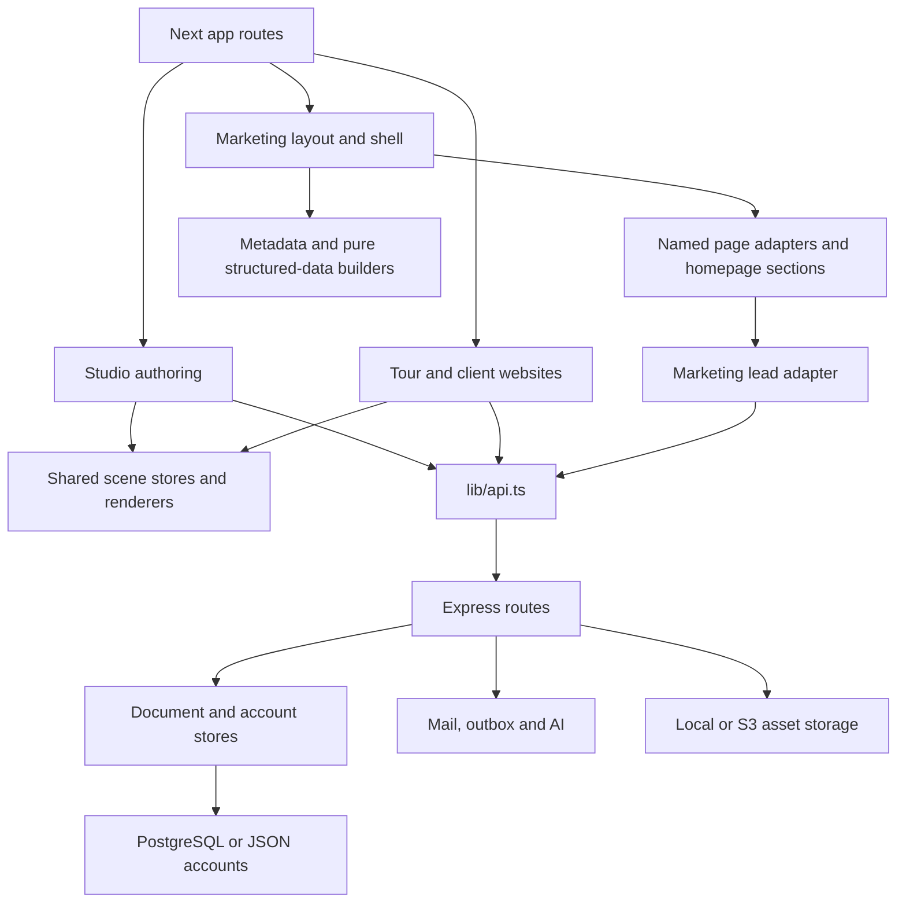

# RCAAS architecture

Reviewed 15 November 2026. This describes the current checkout, including earlier booking, storage and notification work. It is not a deployment signoff.

## Dependency map and ownership

Routes own parameters, server metadata, redirects and not-found decisions. Ordinary marketing pages do not depend on the 3D renderer. Interactive demos keep their own ownership. Studio and tours intentionally share scene documents, rendering, camera, collision and loaders: duplicating those would risk divergent serialization and rendering behavior.

Express configures middleware and mounts domain routers. Routes delegate persistence to stores and delivery to mail/notification/outbox modules. `usersStore.js` selects PostgreSQL or file accounts. The shared `visibleProject` guard lives in `middleware/projectAccess.js`, breaking the properties/sites router initialization cycle; the old export remains compatible. Authentication, persistence contracts and data directories were not changed by the architecture refactor.

## Public website

The former marketing App combined custom browser history, shared chrome, page selection and about a thousand lines of structured data. The homepage combined ten sections, copy and responsive masonry state. A catch-all hid ordinary public URLs from the route tree.

All 42 listed public URLs now have native ownership under `app/(marketing)`. Ordinary routes import named client adapters directly. Industry and case-study detail URLs use `[slug]` routes with server validation and `generateStaticParams`. Blog posts and pagination use a blog-scoped `[...slug]` route, preserving draft previews, pagination rules and publication metadata. The root `[...slug]` handles only the two existing moved URLs and unknown-page handling. It no longer selects content.

The persistent layout owns `MarketingShell`, the header/footer, planner/register state, transition effects and one main landmark. Navigation uses Next's router. Existing content still receives navigation/planner callbacks through `useMarketingPageProps`; adapters retain `next/dynamic` page loading. Nonserializable industry content, such as icon functions, is resolved in its client adapter from a validated slug.

The old `marketing/App.tsx` and `routing/MarketingPage.tsx` were removed after replacement routes passed browser and build checks. `pages/HomePage.tsx` remains a compatibility re-export. The actual homepage is a short composition of ten named sections in `home/components`, with local copy and types. Existing content compositions stay in `pages`; moving them merely to rename concurrently edited files provides little benefit.

Server metadata uses `routing/metadata.ts`. `routing/useMarketingMetadata.ts` owns only client document updates. Pure JSON-LD builders live in `structuredData`: services, places/work, editorial and company data. Shared FAQ arrays live in `content/pageFaqs.ts`, so metadata no longer imports entire UI page modules to read answers. The extracted graph matched the prior output in 98 route/query cases; publication gates and unresolved-answer filtering have unit coverage.

## Studio and shared platform

`EditorShell.tsx` is now a 258-line composition and selection/lifecycle coordinator. `studio/editor` owns named modules for the hierarchy/filmstrip, hotspot/collision/track/scene inspectors, floor-plan tools, model placement, draft controls and top bar/account navigation. These modules range from 64 to 310 lines. Shared numeric controls/options live in `controls.tsx`; Selection/Pose contracts live in `types.ts`. All 29 function bodies checked in this extraction matched the preceding implementation exactly. Publishing and its private dialog remain in `studio/publishing/PublishButton.tsx`, retaining draft saving, expected revisions, conflict recovery, versions, embeds and portals.

The browser fixture exercises actual extracted components and scene/draft actions, with every API request intercepted and a mocked renderer bridge. It verifies numeric commit/cancel/clamping, selection controls, hierarchy filtering/selection and rename commit/cancel, hotspot coordinate/payload preservation, collision-size limits, editable versus baked tracks, saving dirty edits before publishing, asset-reference preservation, blockers, unpublishing and revision conflicts on desktop and phone. This is focused workflow coverage, not a claim of a complete authenticated editor or GPU test.

Scene lifecycle, rendering and `lib/api.ts` retain their existing boundaries. SDK files, Three version, asset references, history, drafts, publishing snapshots and booking behavior are unchanged. The earlier import scan inspected 335 modules and 1,031 relative edges. Its two frontend cycles used type-only `Intent` imports; the runtime backend router cycle was removed through the shared guard.

## Verification and deployment boundaries

Run `npm test`, `npm run lint`, `npx tsc --noEmit`, `npm run build` and `npm run test:e2e`. Playwright is the only added dependency, development-only and explicitly approved. CI installs Chromium before browser checks.

`scripts/browser-test-server.mjs` creates a disposable checkout under ignored `qa-bug-hunt`, links dependencies and adds the test-only Studio route there. Fixtures are absent from the real application route tree and production export. Test API calls never reach a live provider. `PLAYWRIGHT_BASE_URL` targets an existing preview and skips Studio fixture tests, which require the isolated checkout.

Browser coverage checks the listed URL matrix plus visible blog posts, per-page metadata, draft noindex, unknown content, aliases, homepage sections/planner, enquiry query/hash/history, service controls and login/Studio entry URLs. Export validation also uses the `/RCAAS` base path. The existing static deployment excludes API-dependent platform routes; the full Node build retains them.

Live database accounts, mail/provider delivery, actual bookings, physical mobile GPU behavior and public deployment require separate evidence. Desktop GPU rendering and critical authenticated workflows were verified during the final audit described below. No commit, push or deployment was performed by the agent.

## References and next boundaries

Reviewed `prabhatbhusal/polk_road` main, homepage `src/app/page.tsx` (commit tree `0e152c5`): named section composition is useful, while RCAAS retains feature boundaries needed by its platform. The local checkout remains authoritative. The Developer Guide generator and blueprint text were reviewed. The final audit extracted/reviewed all 27 pages of the actual Feature Book and recorded implementation discrepancies in FEATURE_BOOK_REVIEW.md.

The architecture foundation, native routing, structured-data separation, Studio component extraction and backend guard extraction are implemented. Further scene/API splitting is deferred unless a demonstrated maintainability benefit and adequate regression coverage justify it. Authentication, tours, booking, storage and integrations retain their established feature/store ownership instead of acquiring empty layers. The hall calendar, tour booking-card redesign, multi-selection, camera timeline and conflict-merge screen remain separate feature work.

Routing/metadata phase validation: 70 client/tooling tests and 192 server tests passed (262 total, two server skips). TypeScript and the full Node production build passed. Lint has zero errors and six existing warnings. All 16 desktop/phone browser checks passed in the isolated Node checkout; the `/RCAAS` static export built and passed its 10 applicable checks (six Studio fixture checks intentionally skip against an external preview). No fixture route appears in the production route manifest. JSON-LD matched the original in 98 cases and all six initially extracted Studio function bodies matched exactly. Commands/results are retained under ignored `qa-bug-hunt/architecture-next-*`.

Editor component phase validation: all 29 checked function bodies matched the preceding source. Types, full Node production build and 262 unit/API tests passed (two server skips). Lint retained zero errors and six warnings. All 12 affected desktop/phone Studio browser checks passed, including six new hierarchy/inspector checks. Marketing and static-export behavior was unchanged by this editor-only phase, so its earlier passing coverage was not rerun. Results are under `qa-bug-hunt/editor-phase-two-*`.

The long-running development server retained a stale webpack reference after `MarketingPage.tsx` was deleted, despite clean builds passing. Restarting the verified project development stack and clearing only `.next/dev` resolved the live HTTP 500. Home, About, How We Work and Visual Storytelling returned HTTP 200 afterward. Restart development after route/module deletions; a clean isolated test checkout cannot certify the hot-reload state of an already running server.

## Final verification and acceptance

See [ARCHITECTURE_COMPLETION.md](ARCHITECTURE_COMPLETION.md) for the original-prompt status matrix, final code-quality findings, commands and limits; [FEATURE_BOOK_REVIEW.md](FEATURE_BOOK_REVIEW.md) for the actual PDF comparison; and [ARCHITECTURE_CHANGED_FILES.md](ARCHITECTURE_CHANGED_FILES.md) for the reviewed inventory. Final results: 262 unit/API tests passed, two skipped; types/build/static export passed; lint zero errors/six existing warnings; 22 component/public browser checks, 10 production-route checks, 10 static-export checks, and two real critical workflow scenarios passed. The critical suite uses an isolated production frontend, file-backed API, synthetic account/project and copied genuine LCC2 capture. It verifies login/session, actual GPU rendering, rename, hotspot creation/coordinate editing, undo/redo, save, publish, anonymous tour rendering after the entrance veil clears, and unchanged prior published snapshots. The original source scene and all 38 capture files (65,754,605 bytes) retained their hashes. The browser reported an NVIDIA RTX 4070 Ti SUPER via ANGLE/D3D11; physical mobile devices and real PostgreSQL/providers remain unverified. No deployment or further scene/API restructuring was performed.
