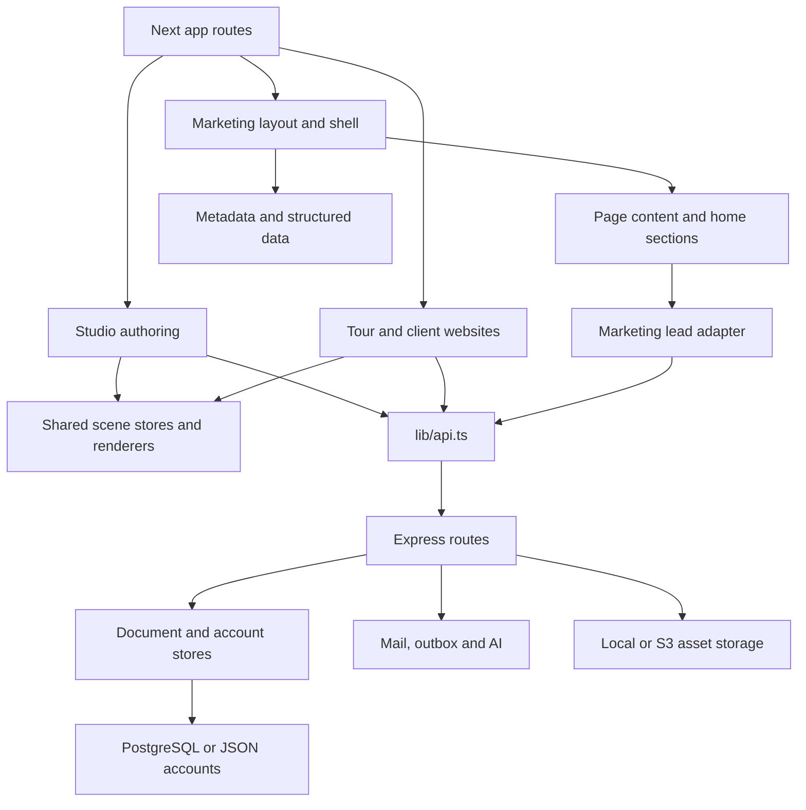

# RCAAS architecture

Reviewed 15 November 2026. This describes the checkout, including existing uncommitted booking, storage and notification work. It is not a deployment signoff.

## Dependency map and ownership

Routes do request-time metadata, redirects, parameters and not-found decisions. Marketing has no dependency on the 3D renderer for ordinary pages. Interactive marketing demos retain their own ownership. Studio and public tours intentionally share scene stores, camera, collision and loader modules; separating those by copying them would risk divergent serialization and rendering behavior.

The Express entry point configures middleware and mounts domain routers. Routes already delegate persistence to stores and delivery to dedicated mail/notification/outbox modules. Accounts use `usersStore.js` to select PostgreSQL or file storage. The shared `visibleProject` HTTP guard now lives in `middleware/projectAccess.js`, breaking the properties/sites router initialization cycle. The old export remains compatible. No authentication behavior, persistence, API contract or data directory was changed.

## Original problems and changes

The marketing App combined browser history, shared chrome, all page selection and roughly a thousand lines of structured-data logic. The 670-line homepage mixed ten sections, copy and responsive masonry state. A catch-all hid every ordinary public URL from the route tree.

The `(marketing)` route group now contains native entries for all 42 listed public URLs, including `/`. The layout owns one `MarketingShell`, one main landmark, the header/footer, planner/register state and existing transition effects. Navigation uses Next's router. `routing/MarketingPage.tsx` is a retained compatibility adapter for existing callback-based content; it no longer owns URL history or layout. `routing/useMarketingMetadata.ts` preserves existing client structured-data behavior separately. Server metadata uses `routing/metadata.ts` for native entries.

The non-optional `[...slug]` fallback retains moved URLs, blog posts/pagination, and server 404 handling. Its static parameter list excludes the explicit native entries, preventing overlaps. Blog/content fallbacks remain deliberately available until their own migration has full coverage; this is not a claim that every content component has become a Server Component.

Homepage sections live in `features/marketing/home/components`, with a short composition, local copy and local types. `pages/HomePage.tsx` and `App.tsx` are compatibility exports. They are retained to protect existing imports rather than deleted based on filenames alone.

## Preserved boundaries and risks

Studio's editor shell, scene lifecycle and `lib/api.ts` remain large. They carry coupled selection/history, rendering and HTTP/revision behaviors and need targeted extraction tests before further work. The import scan inspected 335 modules and 1,031 relative import/export edges. Its two frontend cycles pass through a type-only `Intent` import and are not runtime initialization cycles; the real properties/sites cycle was removed by extracting the shared guard. SDK files, Three version, asset references, undo/redo, drafts, publishing snapshots and booking behavior are unchanged by this work.

The current service/industry content components remain in `marketing/pages`; their native entries are under `app/(marketing)`. Moving those concurrently edited files just for naming would add risk without changing ownership. Do future moves one feature at a time, preserving compatibility imports until callers migrate.

## Verification and remaining work

`npm test`, `npm run lint`, `npx tsc --noEmit`, `npm run build` and `npm run test:e2e` are the checks. Browser tests isolate network writes, cover the complete listed URL matrix, home composition/planner, unknown routes, enquiry query/history and service controls on desktop and phone. They do not certify actual email delivery, database deployment, GPU rendering or the remaining booking redesign.

The existing CI static build still excludes only API-dependent platform routes. Marketing remains compatible with `/RCAAS` and root hosting; base-path behavior must be tested on the exported artifact as well as the Node build. Native entries must have unique URL ownership.

Reference reviewed: `prabhatbhusal/polk_road` main, homepage `src/app/page.tsx` (commit tree `0e152c5`), which composes named landing sections. RCAAS adopts that discoverability while retaining feature boundaries required by the platform. The current checkout remains authoritative over remote main. The Developer Guide generator and blueprint text were reviewed; both guide PDFs are present, but the Feature Book binary was not independently text-extracted in this pass.

Further staged work: direct per-page adapters replacing the remaining selection adapter; dedicated dynamic blog/work/industry route families; smaller structured-data builders; focused EditorShell/scene/API extractions with editor/browser fixtures. The booking calendar, tour booking-card design, multi-select, track timeline and conflict-merge screen are separate feature tasks, not completed by this architecture change.

## Change inventory and phase handoff

The route group moved from `(site)` to `(marketing)` and its optional catch-all became `[...slug]`. Forty-two explicit entries now own the listed URLs. New homepage files are `HomeRoute`, `HomePage`, `data`, `types` and ten section components. New shell/routing files isolate action context, structured data, metadata and a standalone not-found adapter. `App.tsx` and the former HomePage path remain compatibility exports. The shared backend guard moved into middleware, with a re-export for existing callers.

Playwright is the only added dependency (`@playwright/test`, development-only). `playwright.config.ts`, `test/browser/marketing.spec.ts`, the npm command and CI browser steps provide repeatable coverage. Browser reports are ignored by both Git and ESLint. Architecture Markdown is explicitly tracked while generated PDFs and other existing document assets remain ignored. The developer-guide generator's route map and instructions were updated; no new claim is made about regenerating the PDF binary.

Phases 1–3 delivered the audit, conventions and home extraction. Service/industry ownership stays in the existing feature rather than renaming concurrent content edits; native entries make those URLs discoverable. Routing and shared-shell changes are covered by tests. Studio/scene boundaries were reviewed and intentionally retained pending dedicated editor fixtures. Backend changes are limited to the verified guard extraction. Compatibility files were retained rather than deleting unverified consumers. This is a tested architecture foundation, not a claim that every oversized module or planned feature is finished.

Validation record: 67 client/tooling tests plus 192 server tests passed (259 total, two intentional skips). TypeScript and the full production build passed. Lint passed with six pre-existing warnings. The public route/home/navigation suite passed eight checks across desktop/phone on both the Node preview and `/RCAAS` static preview; the final expanded run additionally checks login/studio entry URLs and the rendered 404. The production and static-export commands are recorded under ignored `qa-bug-hunt/architecture-*`. Live database authentication, actual GPU rendering, mail/provider delivery, real booking submission, editor interactions and public deployment were not verified by this suite. Nothing was committed, pushed or deployed by the agent.

The default `npm run test:e2e` command passed with Playwright's installed Chromium, without a Chrome channel override. All ten extracted homepage section JSX trees matched the saved pre-refactor source exactly. Browser startup reports harmless colour-environment warnings; requesting the Studio entry also exposes an existing React warning about a script tag rendered as a component. The suite does not treat that as proof the script executes or as an authenticated editor test.
